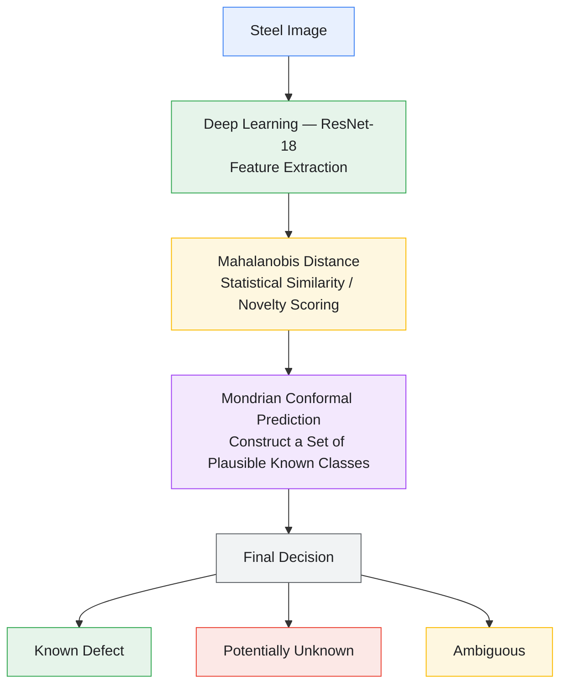

# NovaSight — Open-Set Steel Defect Inspection

**An industrial steel-surface inspection platform for known defect recognition, unknown defect detection, and few-shot defect enrollment.**

NovaSight separates offline representation learning and statistical artifact generation from the production inference and persistence runtime. It combines deep feature extraction, Mahalanobis-distance-based scoring, conformal prediction, and operator-guided enrollment to support steel-surface defect inspection.

> **Research disclaimer:** NovaSight v1.0 is a historical, exploratory implementation. Model selection involved test-split leakage, so the historical benchmark metrics are not validated estimates of generalization performance. Rigorous evaluation under the updated protocol is required before production use.

## Table of Contents

- [Overview](#overview)
- [Key Features](#key-features)
- [System Architecture](#system-architecture)
- [Algorithms and Models](#algorithms-and-models)
- [Known Defect Classes](#known-defect-classes)
- [Five-Shot Defect Enrollment](#five-shot-defect-enrollment)
- [Technology Stack](#technology-stack)
- [Repository Structure](#repository-structure)
- [Installation and Local Execution](#installation-and-local-execution)
- [Deployment](#deployment)
- [Artifact Integrity and Provenance](#artifact-integrity-and-provenance)
- [Evaluation and Limitations](#evaluation-and-limitations)
- [Future Work](#future-work)

## Overview

Conventional closed-set classifiers generally assign an input to one of the classes seen during training. In manufacturing environments, however, defects can appear that are not represented in the training data.

NovaSight addresses this challenge through an **open-set recognition** workflow. It extracts image representations, evaluates their statistical compatibility with known defect classes, and uses conformal prediction to construct a prediction set.

Depending on the result, the application can:

- Return a known defect classification.
- Flag a sample with an empty prediction set as potentially unknown.
- Flag a sample with multiple plausible classes as ambiguous.
- Allow an operator to propose a new defect class through a five-shot enrollment workflow.

NovaSight is a research and review prototype, not a certified industrial inspection system.

## Key Features

- **Deep feature extraction:** ResNet18-based image representations produced through ONNX Runtime.
- **Statistical anomaly scoring:** Mahalanobis-distance-based scoring against modeled defect distributions.
- **Conformal prediction:** Class-specific calibration scores and prediction-set-based decisions.
- **Open-set decision handling:** Separate outcomes for known, potentially unknown, and ambiguous inputs.
- **Five-shot enrollment:** A workflow for proposing a new defect class from five representative images.
- **Enrollment safety gate:** Novelty, consistency, and overlap checks before enrollment.
- **Persistence and traceability:** Application records and runtime memory backed by the configured storage implementation.
- **Artifact provenance verification:** SHA-256 checks before model artifacts are loaded.
- **Web interface:** A Gradio application designed for inspection, enrollment, and model-evidence review.

## System Architecture
## NovaSight Inference Workflow




## Bounding-Box Visualization and Defect Localization

NovaSight's dataset inspection workflow includes functionality for visualizing the location and extent of steel surface defects using bounding boxes. The current bounding-box viewer uses **ground-truth annotations from the NEU-DET dataset**, rather than bounding boxes predicted by an object-detection model.

### 1. Dataset Image Loading

The dataset viewer loads steel defect images from the NEU-DET dataset directory. These images provide visual examples for examining defect regions and their associated annotations.

### 2. Annotation Parsing

The `neu_det.py` functionality reads Pascal VOC XML annotation files. These files contain information such as:

- Defect class labels.
- Bounding-box coordinates.
- Annotated defect locations within an image.

The annotation coordinates describe the defect regions provided by the dataset.

### 3. Bounding-Box Visualization

The viewer uses the parsed coordinates to draw rectangular bounding boxes over the corresponding images. These rectangles help users identify the spatial location and approximate extent of annotated defects.

### 4. Defect Identification Support

The bounding-box visualization provides spatial context for the dataset's defect labels. It supports visual inspection, annotation review, and understanding of defect locations.

### Ground-Truth vs. AI-Predicted Bounding Boxes

| Feature | Current implementation |
|---|---|
| Load NEU-DET images | Yes |
| Read Pascal VOC XML annotations | Yes |
| Draw annotated bounding boxes | Yes |
| Display ground-truth defect labels | Yes |
| Generate bounding boxes using an AI object-detection model | Not currently implemented / confirmed |
| Evaluate predicted bounding boxes against ground truth | Not currently implemented / confirmed |

### Relationship to the Classification Pipeline

NovaSight's ResNet-18 feature extractor, Mahalanobis-based scoring, and Mondrian conformal prediction support **image-level defect recognition and unknown-defect detection**. The annotation-based bounding-box viewer is a separate dataset-visualization component.

Image-level classification identifies a defect category, while object detection predicts both a category and its spatial location through bounding-box coordinates.

The current annotation viewer displays the dataset's ground-truth boxes; it should not be interpreted as evidence that the classification pipeline predicts defect locations.

### Future Enhancement: AI-Based Defect Localization

To support genuine AI-predicted bounding boxes, the project would need an object-detection or localization model that predicts defect coordinates and class labels directly from an input image. Potential approaches include YOLO-based detection or other suitable object-detection architectures.

The predicted boxes could then be evaluated against ground-truth annotations using metrics such as Intersection over Union (IoU), precision, recall, and mean Average Precision (mAP).

**Implementation note:** An empty `boxes.json` generated by `prepare_dataset.py` is only a placeholder and does not contain trained or predicted bounding boxes.


### Runtime flow

1. Validate and preprocess the input image.
2. Extract a 512-dimensional feature representation using the ResNet18-based ONNX model.
3. Calculate statistical scores relative to known-class distributions.
4. Apply conformal prediction using the stored calibration information.
5. Produce a known-class, potentially unknown, or ambiguous result.
6. Persist relevant application events and make them available for review.

The exact decision behavior depends on the implementation, calibration assumptions, and configured thresholds.

## Algorithms and Models

### 1. ResNet18 feature extractor

ResNet18 is a convolutional neural network used to learn visual representations of steel-surface images. NovaSight uses its feature-extraction output to represent each input as a 512-dimensional vector.

The deployed feature extractor uses ONNX Runtime, allowing inference without importing PyTorch into the runtime scoring path.

### 2. Mahalanobis distance

Mahalanobis distance measures the deviation of a feature vector from a modeled distribution while accounting for feature covariance.

For a feature vector \(x\), class mean \(\mu\), and covariance matrix \(\Sigma\):

\[
d_M(x)=\sqrt{(x-\mu)^T\Sigma^{-1}(x-\mu)}
\]

In the implementation, the statistical scoring path uses the corresponding precision matrix and the configured scoring procedure.

A larger distance generally indicates that a sample is less typical of the modeled distribution. It is a statistical score, not a probability that a defect is unknown.

### 3. Mondrian conformal prediction

Mondrian conformal prediction uses class-specific calibration scores to assess candidate labels. The resulting prediction set can contain one class, multiple classes, or no classes.

- **Singleton set:** one candidate remains.
- **Empty set:** no known class remains under the selected decision rule; the sample is flagged as potentially unknown.
- **Multiple candidates:** the result is treated as ambiguous.

Conformal guarantees depend on appropriate calibration and exchangeability assumptions. An empty set does not prove that a sample belongs to a genuinely new defect category.

### 4. Five-shot enrollment

The enrollment procedure uses five representative images to propose a new class. It extracts their features and evaluates the enrollment safety gate before adding the class to runtime memory.

This procedure does not retrain the entire ResNet18 feature extractor.

## Known Defect Classes

The configured base artifact contains five known defect categories:

1. Crazing
2. Inclusion
3. Patches
4. Pitted surface
5. Rolled-in scale

The project uses the NEU-CLS steel-surface defect dataset in its offline research workflow. Dataset splits, calibration, and evaluation must remain separated appropriately to support unbiased assessment.

## Five-Shot Defect Enrollment

NovaSight provides an operator-guided workflow for proposing a new defect class from five representative images.

The intended process is:

1. Enter a name for the proposed defect class.
2. Upload five representative images.
3. Extract feature vectors and evaluate input consistency.
4. Run the enrollment safety gate.
5. Accept the enrollment, request review, or reject the proposal according to the gate result.
6. Store the enrolled class in runtime memory if enrollment is permitted.

The safety gate considers checks such as novelty, consistency, and overlap. Its output is a workflow decision, not proof that the proposed category is scientifically distinct.

Enrollment quality depends on the representativeness of the five images and the reliability of the feature space. It must be evaluated separately from the base classifier.

## Technology Stack

| Component | Technology |
|---|---|
| Programming language | Python |
| User interface | Gradio |
| Feature extraction model | ResNet18 |
| Inference format and runtime | ONNX, ONNX Runtime |
| Numerical operations | NumPy |
| Image preprocessing | Pillow and NumPy |
| Statistical scoring | Mahalanobis distance |
| Prediction-set method | Mondrian conformal prediction |
| Configuration | YAML |
| Application persistence | Configured SQLite or PostgreSQL backend |
| Web hosting | Render |
| Artifact integrity | SHA-256 provenance verification |

## Repository Structure

The following is a high-level description of the project organization. Exact filenames and optional components may differ by revision.

```text
NovaSight/
├── app.py
├── requirements-app.txt
├── README.md
├── configs/
│   └── default.yaml
├── artifacts/
│   ├── base/
│   │   ├── metadata.json
│   │   ├── gaussian.npz
│   │   ├── class_means.npz
│   │   └── conformal.npz
│   └── provenance.json
├── models/
│   └── onnx/
│       └── resnet18_b0_l4.onnx
└── src/
    ├── runtime/
    │   ├── artifact.py
    │   ├── scoring.py
    │   ├── preprocess.py
    │   ├── onnx_extractor.py
    │   └── gate.py
    ├── app/
    │   └── storage.py
    ├── config.py
    └── utils/
```

## Installation and Local Execution

### Prerequisites

- Python version compatible with `requirements-app.txt` (the deployment has been configured for Python 3.12.10).
- Git.
- The required model and statistical artifacts.
- The dependencies specified in the repository.

### 1. Clone the repository

```bash
git clone https://github.com/VINYTHA1708/NovaSight.git
cd NovaSight
```

### 2. Create a virtual environment

Windows PowerShell:

```powershell
py -3.12 -m venv .venv
.\.venv\Scripts\Activate.ps1
```

macOS or Linux:

```bash
python3.12 -m venv .venv
source .venv/bin/activate
```

### 3. Install dependencies

```bash
python -m pip install --upgrade pip
pip install -r requirements-app.txt
```

### 4. Run the application

```bash
python app.py
```

Open the local URL printed in the terminal by Gradio.

**Important:** Local execution requires all referenced artifacts and model files to exist and pass the integrity checks. A successful application launch alone does not establish that inference is operational.

## Deployment

NovaSight is configured for deployment as a Render web service.

The deployment configuration uses:

- **Build command:** `pip install -r requirements-app.txt`
- **Start command:** `python app.py`
- **Python version:** `3.12.10`
- **Branch:** `app-mvp`

The application URL configured for this deployment is:

https://novasight-zxjc.onrender.com

Deployment status does not imply that the model has loaded successfully. Verify the runtime logs and test the application after each deployment.

## Artifact Integrity and Provenance

Before loading the statistical artifacts, NovaSight verifies their SHA-256 checksums against `artifacts/provenance.json`.

The checks protect against accidental changes or unexpected artifact contents. If an artifact's raw-byte checksum does not match the recorded value, the runtime refuses to load the artifact.

Do not disable this verification or replace recorded checksums merely to make deployment succeed. Instead:

1. Identify the exact artifact path being loaded.
2. Compare the deployed file's SHA-256 with the committed file.
3. Verify that the provenance record belongs to the same artifact build.
4. Rebuild or redeploy the intended artifacts if they differ.
5. Retest inference after all checks pass.

**Current deployment limitation:** The deployment has exhibited a metadata SHA-256 mismatch. Artifact loading must be resolved and verified before the application can be considered operational.

## Evaluation and Limitations

The Model & Evidence page contains historical v1.0 exploratory results. These results are not validated performance estimates because model selection involved test-split leakage.

The project therefore does not claim that the historical metrics establish generalization to unseen data or readiness for industrial deployment.

Important limitations include:

- Historical evaluation was affected by test-split leakage.
- Rigorous evaluation under the updated protocol remains necessary.
- Five-shot enrollment performance requires further investigation.
- Open-set detection can miss unfamiliar defects or flag unusual examples from known classes.
- Calibration guarantees depend on their statistical assumptions.
- Deployment artifact loading must be repaired and verified.

The system should be treated as a research and review prototype. It should not be used as the sole basis for manufacturing quality or safety decisions.

## Future Work

1. Resolve the artifact-integrity mismatch and verify reproducible deployment.
2. Complete evaluation with strict separation of training, validation, calibration, and test data.
3. Investigate five-shot enrollment quality and improve the enrollment gate.
4. Test robustness across defect variations and acquisition conditions.
5. Improve operator feedback, auditability, and error handling.
6. Evaluate on representative industrial data before considering production use.

## Author and Repository
## Team Details

**Team Number:** 21

| S. No. | Team Member Name |
|:------:|------------------|
| 1 | VINYTHA S V |
| 2 | AKSHAYAA S A |
| 3 | THEERTHA E |
| 4 | SWASTHIKA P |


**Project:** NovaSight — Open-Set Steel Defect Inspection

**Repository:** [VINYTHA1708/NovaSight](https://github.com/VINYTHA1708/NovaSight)

**Implementation Deployment:** https://steeldefectinspector.onrender.com

**Report Deployment:** https://novasight-zxjc.onrender.com/
